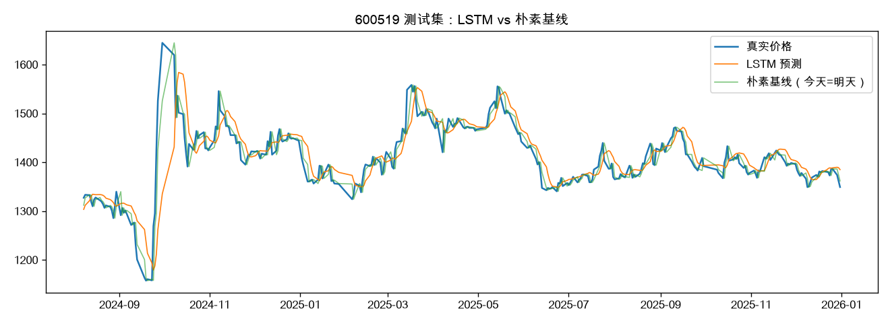

# A 股股价预测入门：LSTM vs 朴素基线

> 软件工程（金融科技）本科生的入门练习项目。目标不是做出"能赚钱"的模型，而是**亲手跑通一次完整的金融时序预测流程，并诚实地评估结果**。

## 做了什么

1. **数据**：用 [akshare](https://github.com/akfamily/akshare) 获取贵州茅台（600519）2019–2025 年日线数据（前复权）。
2. **模型**：用 PyTorch 实现 2 层 LSTM，输入过去 30 个交易日的收盘价，预测下一日收盘价。
3. **对照**：朴素基线"明天价格 = 今天价格"。
4. **评估**：按时间顺序划分训练集（前 80%）/ 测试集（后 20%），计算 MAE、RMSE 和涨跌方向准确率。

## 结果

| 方法 | MAE（元） | RMSE（元） | 方向准确率 |
|---|---|---|---|
| LSTM | 23.88 | 39.38 | 48.2% |
| 朴素基线（今天 = 明天） | **13.98** | **22.59** | — |



**观察**：
- LSTM 的误差明显**大于**朴素基线，预测曲线整体比真实价格"滞后一天"——模型在很大程度上学到的是"复制前一天的价格"。
- 误差最大的区间是 **2024 年 9 月底**政策驱动的急涨（约 1160 → 1640 元），只用历史价格的模型无法捕捉这类外部信息。

## 我的思考

- **价格序列高度自相关**，"今天 ≈ 明天"本身就是一个很强的基线；只看预测误差，很容易高估模型的能力。
- **外部信息很关键**：2024 年 9 月底的急涨来自政策消息，价格序列本身不包含这类信息，这让我理解了引入新闻等多源信息（如用大模型分析新闻情感）的意义。
- **预测准 ≠ 能赚钱**：方向准确率约 50%，说明模型对涨跌几乎没有预测力。这让我理解了为什么相关研究会：
  - 引入 **K 线形态识别**等额外信息（如 Informer 日内价格预测的研究）；
  - 直接以**投资收益**为优化目标（如基于强化学习的投资组合管理）。
- **数据处理细节很重要**：归一化参数只能用训练集计算，否则会造成数据泄露；不同数据源的前复权算法不同，同一天算出的涨跌幅可能不一致。

## 附：红三兵形态识别（pandas 向量化实现）

用 `shift()` 把"连续 3 根阳线、收盘价逐日升高"写成布尔条件，信号标在第三天，避免使用未来数据。
在茅台 2021–2025 年数据上：

| 定义 | 出现次数 | 出现后 5 日平均收益 |
|---|---|---|
| 基础版（连续 3 阳 + 收盘递增） | 71 | [填入你的结果] |
| 加严版（+ 每天开盘落在前一天实体内） | 11 | [ ] |
| （对比）所有交易日 | — | [ ] |

结论：[与"看涨信号"的直觉相符 / 不符]。另外注意到连续上涨时同一段行情会被重复识别（如 2021-10-08 至 10-13 连续 4 天触发），严谨统计时需要去重。

## 下一步

- [ ] 改为预测**收益率**而非价格，加入成交量等更多特征
- [ ] 用 **Informer / Transformer** 替换 LSTM 做对比
- [ ] 把 K 线形态作为特征输入模型，观察是否提升

## 运行方式

```bash
pip install akshare pandas numpy matplotlib torch
python lstm_demo.py
```
或在 VS Code / Jupyter 中打开 `lstm_demo.ipynb` 逐格运行。
